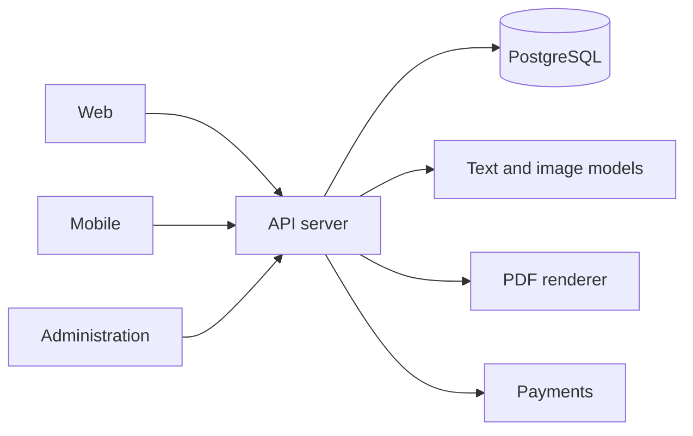
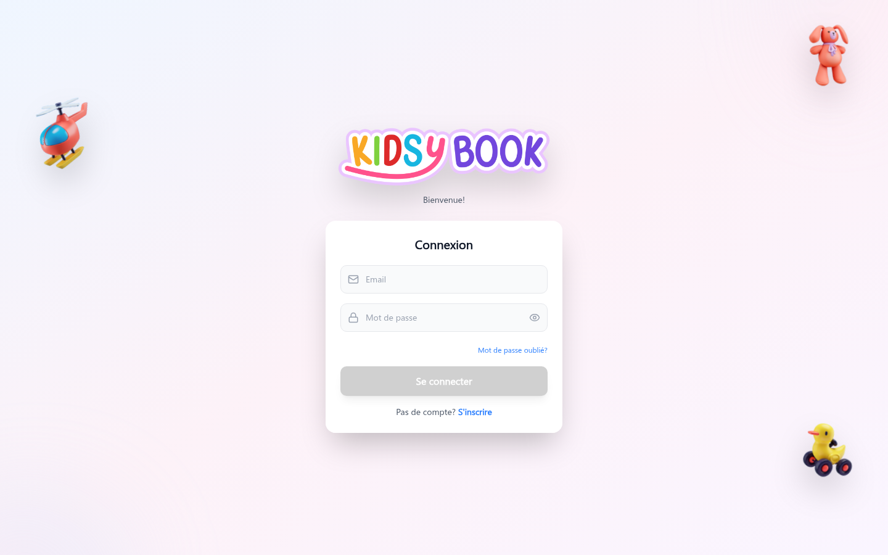
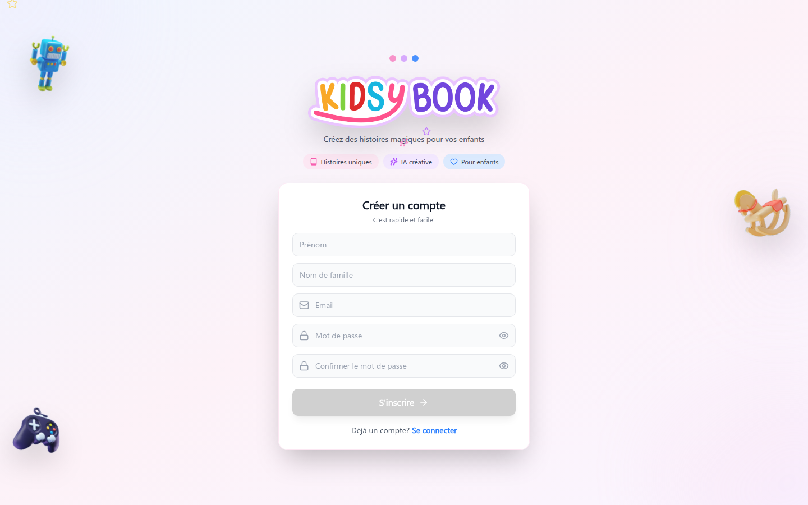
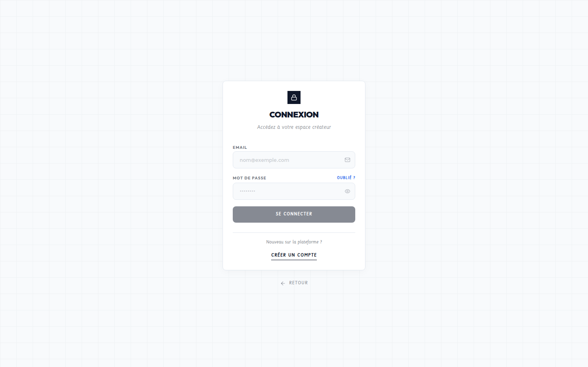
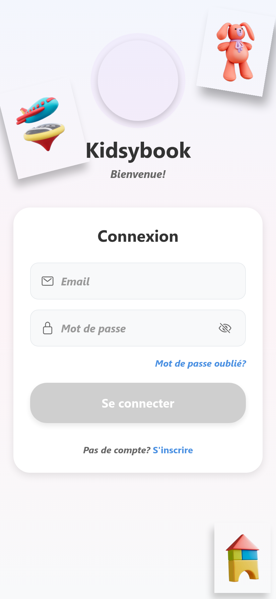
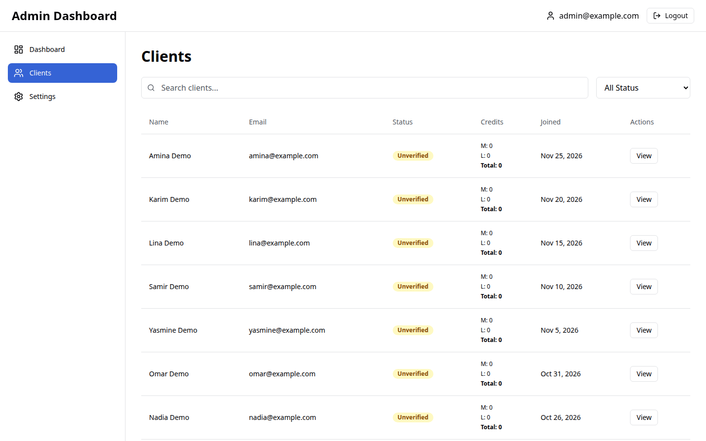
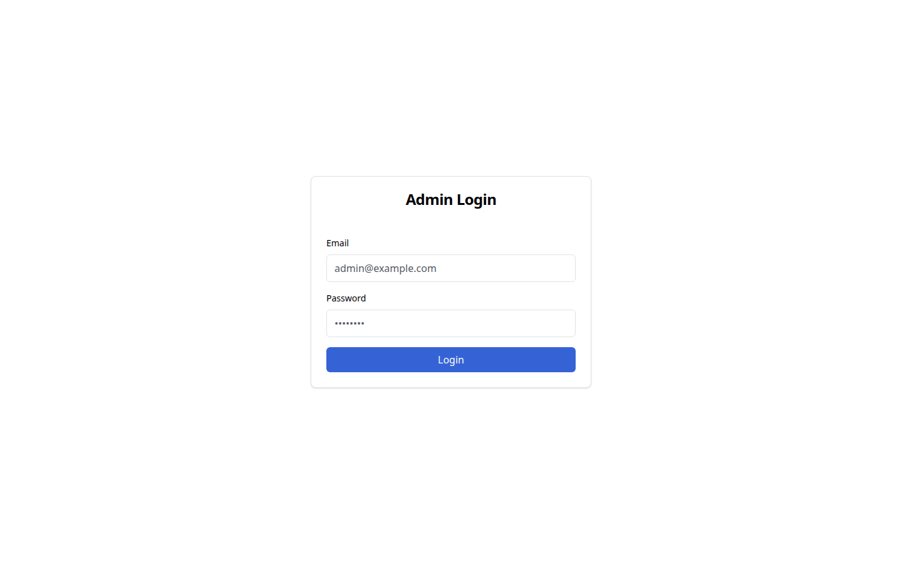

# KidsyBook

Personalized illustrated stories for children, generated with AI.

Parents create a child profile, describe an idea and receive a personalized illustrated story as a PDF. Credits pay for generation, and progress is streamed live.

> **Structure only.** The source code is private. Source files here are intentionally empty so you can see how the project is organized. Commands describe the private codebase.


## Features

- Child profiles with photo
- Conversational story creation
- Illustrations and PDF download
- Several languages
- Credits and payments
- Favorites and regeneration

## Applications

| Application | Role |
| --- | --- |
| [API server](server/README.md) | Express, Sequelize and PostgreSQL |
| [Web application](client-web/README.md) | Main React website |
| [Web application, second design](client-web-v2/README.md) | Redesigned React website with 3D book |
| [Mobile application](mobile/README.md) | Expo and React Native |
| [Administration](admin/README.md) | React administration |

## Architecture



## Engineering highlights

- Generation is asynchronous with live progress
- Credit cost is checked by middleware before generation
- Interchangeable image generation providers
- Scheduled file cleanup

## Screenshots

| Landing page | Sign in |
| --- | --- |
|  |  |
| **Sign up** | **Second design** |
|  |  |
| **Mobile sign in** | **Mobile sign up** |
|  |  |
| **Administration** | **Admin sign in** |
|  |  |

Captured from the real front ends; the administration list uses a mock API with fictional clients. Mobile screens come from the web build.

## Repository layout

```text
server/                                 Express, Sequelize and PostgreSQL
client-web/                             Main React website
client-web-v2/                          Redesigned React website with 3D book
mobile/                                 Expo and React Native
admin/                                  React administration
docs/screenshots/
```

Each application has its own README with responsibilities, dependencies, structure and commands.

## Usage

Published for portfolio and presentation purposes. No license is granted for reuse.
