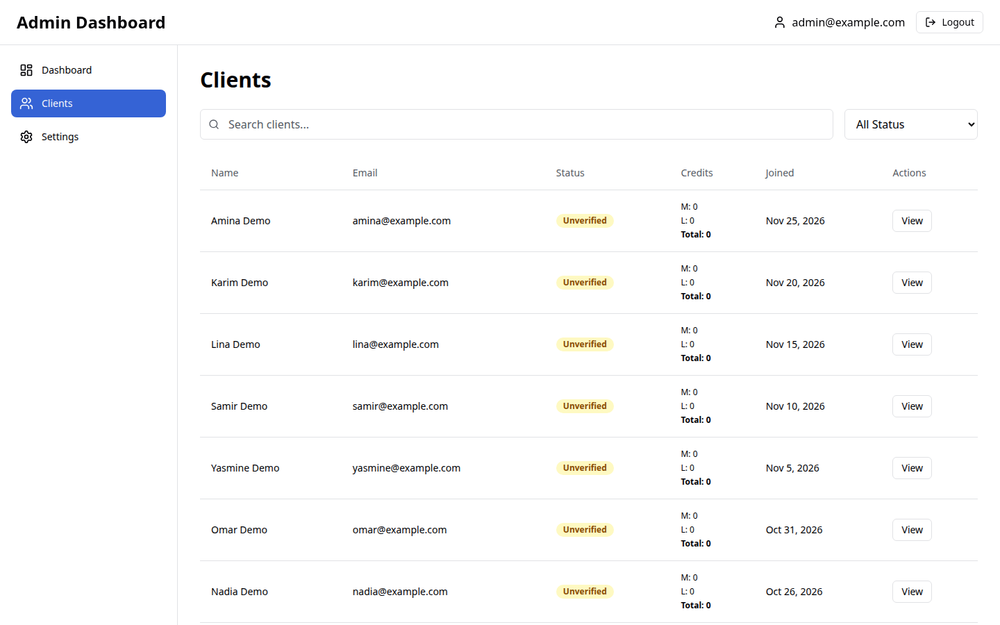
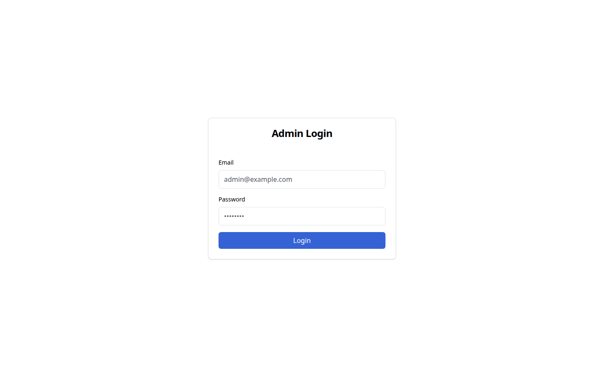

# Administration

React administration. Part of [KidsyBook](../README.md).

> **Structure only.** The source code is private. Source files here are intentionally empty so you can see how the project is organized. Commands describe the private codebase.

## Responsibilities

- Client list and details
- Credit gifts
- Statistics

## Screenshots

| Administration | Admin sign in |
| --- | --- |
|  |  |

## Main dependencies

`@tailwindcss/vite`, `@tanstack/react-query`, `axios`, `class-variance-authority`, `clsx`, `lucide-react`, `react`, `react-dom`, `react-router-dom`, `tailwind-merge`, `tailwindcss`

## Structure

```text
public/                           1 file
src/                              4 files
src/api/                          4 files
src/assets/                       1 file
src/components/                   17 files
src/context/                      1 file
src/hooks/                        3 files
src/pages/                        6 files
src/utils/                        2 files
```

## Commands

```bash
npm install
npm run dev
npm run build
npm run lint
```
