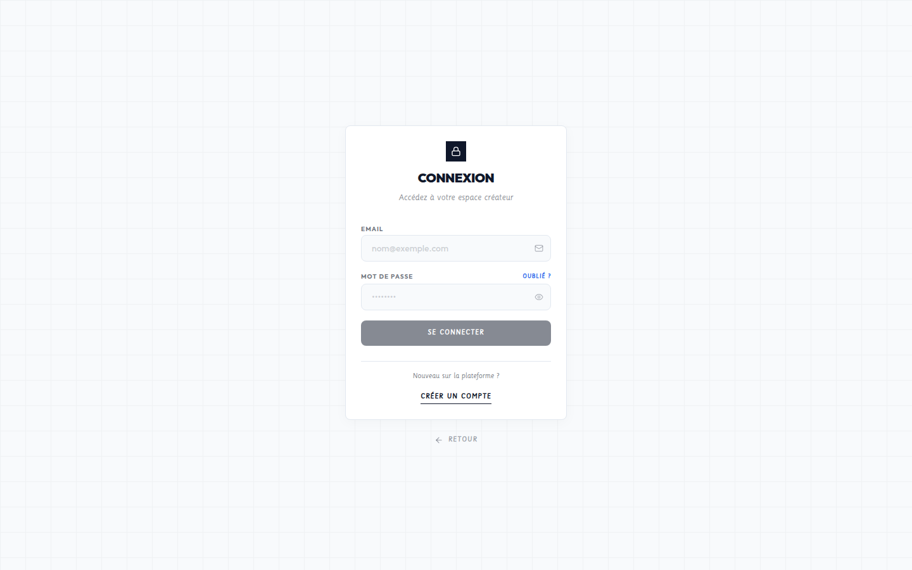

# Web application, second design

Redesigned React website with 3D book. Part of [KidsyBook](../README.md).

> **Structure only.** The source code is private. Source files here are intentionally empty so you can see how the project is organized. Commands describe the private codebase.

## Responsibilities

- Story library and creation
- Points and settings

## Screenshots

| Second design |
| --- |
|  |

## Main dependencies

`@react-three/drei`, `@react-three/fiber`, `@stripe/react-stripe-js`, `@stripe/stripe-js`, `@tailwindcss/vite`, `@tanstack/react-query`, `axios`, `class-variance-authority`, `clsx`, `framer-motion`, `gsap`, `jotai`, `lucide-react`, `maath`, `motion`, `react`, `react-dom`, `react-hot-toast`, `react-router-dom`, `react-toastify`, `socket.io-client`, `tailwind-merge`, `tailwindcss`, `tailwindcss-animate`, `three`, `tw-animate-css`

## Structure

```text
public/                           10 files
src/                              5 files
src/assets/                       14 files
src/components/                   15 files
src/contexts/                     2 files
src/hooks/                        6 files
src/lib/                          4 files
src/pages/                        11 files
src/services/                     4 files
```

## Commands

```bash
npm install
npm run dev
npm run build
npm run lint
```
