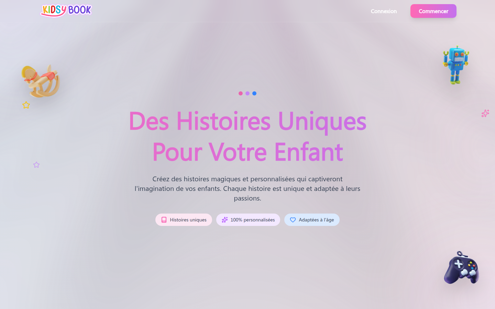
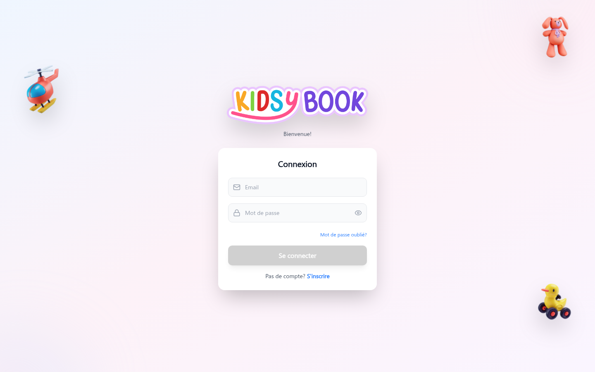
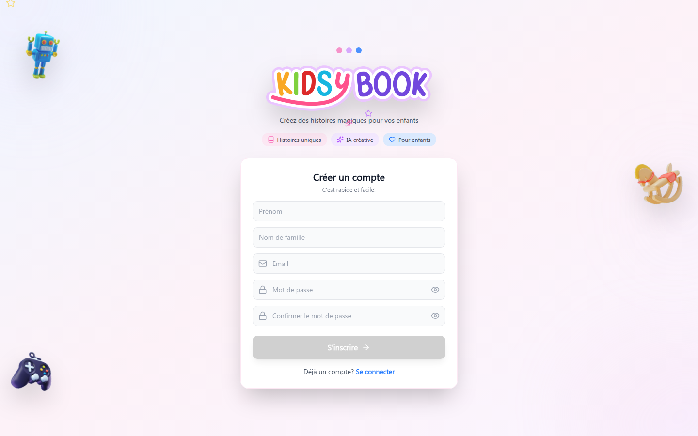

# Web application

Main React website. Part of [KidsyBook](../README.md).

> **Structure only.** The source code is private. Source files here are intentionally empty so you can see how the project is organized. Commands describe the private codebase.

## Responsibilities

- Landing page and accounts
- Story creation and chat
- Credits and profile

## Screenshots

| Landing page | Sign in |
| --- | --- |
|  |  |
| **Sign up** |
|  |

## Main dependencies

`@gsap/react`, `@stripe/react-stripe-js`, `@stripe/stripe-js`, `@tailwindcss/vite`, `@tanstack/react-query`, `axios`, `class-variance-authority`, `clsx`, `framer-motion`, `gsap`, `lucide-react`, `mathjs`, `motion`, `ogl`, `react`, `react-dom`, `react-hot-toast`, `react-router-dom`, `socket.io-client`, `tailwind-merge`, `tailwindcss`

## Structure

```text
public/                           2 files
src/                              4 files
src/assets/                       81 files
src/components/                   32 files
src/contexts/                     2 files
src/hooks/                        6 files
src/lib/                          3 files
src/pages/                        11 files
src/services/                     4 files
```

## Commands

```bash
npm install
npm run dev
npm run build
npm run lint
```
